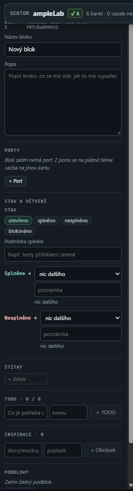

# Panel bloku a portu podle reality

**Stav: rozbor hotový, logika čeká na schválení člověkem, pak návrh UX/UI přes Claude Design (2026-10-31).**
Člověk: „Vytvořený blok má nefunkční menu, agenti ho nevyplňují a nepoužívají. Musí tam být věci potřebné
k úkolu nebo práci agenta, třeba log a historie relací workerů, kteří na tom pracovali.“

## Jak to vypadá dnes

Kód: `frontend/editor/node-detail/tree/`, `frontend/editor/block-editor/`, kontrakt `docs/karta-pro-agenty.md`.

## Rozbor (jen čtení, kód + živá data 8740)

Bloky dnes nikdo neplní. Píše je jen zastaralá cesta `agent-output` / `POST /desktop-v3/block`, kterou skill
zakazuje (`references/hub-loop.md:27`, `legacy.md:9-12`); srdce plánuje jen `spec.steps` (`opora_heart.py`),
bloky nezná. Živý Ample (od 2026-10-30): 0 zápisů `agent-output`, 0 bloků na 11 kartách. Starý lokální Ample
453× `agent-output` (naposledy 2026-10-11), Tajemství 6× (naposledy 2026-10-18).

| sekce | kdo píše | kdo čte | v datech (živý Ample / Tajemství) | verdikt |
|---|---|---|---|---|
| Název, Popis | UI, canvas-plan | node_brief, tvář karty | 0 / 11 z 12 | jen ke čtení |
| Porty | UI, canvas-plan | `CardBlockPorts`, node_brief | 0 / 12 | ponechat jako vazbu; spawn z portu smazat |
| Stav otevřeno/splněno/… | agent-output, UI | checklist, autonomie, spawn | 0 / 5× met | nahradit stavem kroků (agent-state) |
| Podmínka splnění | canvas-plan, UI | node_brief `blockConditions` | 0 / 10 | nahradit `spec.acceptance` + `checks` |
| Splněno → / Nesplněno → | UI | nikdo | 0 / 0 | smazat |
| Poznámka stavu | agent-output | tvář karty | 0 / 5 | smazat |
| Štítky, TODO, Inspirace, Podbloky | UI | jen editor | 0 / 0 | smazat |

## Co OPORA o práci na kartě ví (zdroje dat pro nový panel)

- `GET /api/oporahub/agent-state` `cards[]`: `stage`, `reason`, `nextActionId`, `steps.items`, `pr`, `lease`,
  `dod.missing`, `order`.
- `GET /api/oporahub/executions?nodeId=`: relace dělníků (`owner`, `createdAt`, `state`);
  `GET /api/oporahub/executions/{id}/results`: `summary`, `stepResults[{stepId, status, evidence{notes,
  checks, commits}}]`, `risk`.
- `GET /api/oporahub/events` (`nodeId`, `kind`, `actor`, `prNumber`) a `GET /api/activity-log?nodeId=`,
  `/api/activity-log/latest-by-node` (#228).
- Zprávy na vazbách `state.edges[edgeId]`: `summary`, `handoff`, `agent`, `updatedAt`.
- Detail karty už má záložky Běh / Historie / Review & PR (`hub/oporahub-card-drawer`), panel na ně odkazuje,
  nekopíruje je.

## Návrh logiky panelu (ke schválení)

1. **Hlavička:** název a popis bloku (jen čtení), ID.
2. **Práce na kartě:** etapa a další krok, kroky ✓/…, PR #N, kdo kartu drží a do kdy.
3. **Relace dělníků:** kdo, kdy, stav; rozbalení = shrnutí, kroky s důkazem a commity.
4. **Log změn:** posledních ~10 událostí karty („kdo · kdy · co“), odkaz „Celá historie“ do detailu karty.
5. **Port:** popisek, cílová karta a poslední zpráva na vazbě (co předal a kdo).

## Kdo panel plní: spouštěč → deterministická smyčka → LLM jen na zbytek

Člověk (2026-10-31): karta má šetřit čas a vysvětlování. Co se s úkolem děje, kdo na něm pracuje, co se
stalo a udělalo, doplňují procesy samy. Proces spustí spouštěč, proběhne deterministická smyčka a LLM doplní
jen to, co determinismus nedokáže posoudit nebo udělat.

**Spouštěče (už existují, nic nového se nevymýšlí):** claim, heartbeat, `step`, `deliver` a release exekuce;
commit s trailerem `Opora-Node: N`; PR otevřen / sloučen / zapsán zpět; úkol brány změní stav; výsledek review;
zápis záznamu činnosti s `nodeIds` (#228); událost `tool.use` z hooku relace dělníka.

**Deterministická smyčka (bez modelu, `backend/brain_opora/determinism/` + existující záznamy):** z událostí
skládá **stopu práce karty** a nic si nevymýšlí. Stopa je projekce při čtení, ne nové úložiště; schéma beze změny.

| co karta ukáže | odkud to determinismus vezme |
|---|---|
| kdo teď pracuje, od kdy, do kdy drží | lease exekuce (`owner`, `createdAt`, `expiresAt`) |
| relace dělníků (kdo, kdy, jak skončila) | `executions?nodeId`, stav exekuce |
| kroky ✓ / … / ✗ a co jsou zač | `spec.steps` + `stepResults[].status` |
| důkaz kroku: commity, kontroly zelená/červená, soubory | `stepResults[].evidence` (`commits`, `checks`), `git show --stat` commitu s `Opora-Node` |
| PR a jeho stav, sloučení, zápis zpět | `cards[].pr`, události `pr.*` |
| co dělník právě dělá (nástroj, soubor) | události `tool.use` z hooku relace (posledních pár, bez obsahu) |
| poslední změna karty, kdo, kdy, co | `latest-by-node` (#228) |
| zpráva na portu (co předal dál) | `state.edges[edgeId]` |
| co chybí k hotovu | `dod.missing` z agent-state |

**Hooky a skripty dělníka** jsou jen spouštěče, žádný úsudek: hook relace (Claude Code `PostToolUse` /
`Stop`) a klient brány pošlou událost s `nodeId`, `executionId`, `stepId`. Commit hook zkontroluje trailer
`Opora-Node`. Co dnes dělník musí popisovat ručně (které soubory, které testy prošly, který commit), doplní
smyčka z gitu a výsledků kontrol sama.

**LLM jen tam, kde determinismus nestačí** (srdce, probuzené spouštěčem jen když smyčka nastaví příznak
„potřebuje úsudek“):

- dvakrát červená kontrola nebo zaseknutý krok → krátké vysvětlení příčiny a návrh dalšího kroku;
- doručení bez důkazu pro podmínku hotovo, kterou nejde ověřit kontrolou → posouzení, jestli je splněná;
- konec relace dělníka → jedna věta „co se udělalo“ lidsky (když ji dělník v `summary` nedal);
- rozpor mezi úkolem a výsledkem (jiné soubory, než úkol čekal) → otázka pro člověka.

V panelu je u každé položky vidět původ: ⚙ odvozeno deterministicky, ✦ doplnil model (a který). Člověk tak ví,
čemu věřit bez kontroly a co je úsudek.

Krok 1 (UI): mrtvé sekce pryč z panelu, nové sekce 2–5 nad stopou práce; uložená data beze změny.
Krok 1b (backend): projekce stopy práce karty (`GET` jedna karta, čistá funkce nad existujícími záznamy
s testem) a příznak „potřebuje úsudek“ jako spouštěč srdce; hook relace dělníka posílá `tool.use` s `nodeId`.
První řez (jen čtení, příznaky zatím bez napojení na srdce): `GET /api/oporahub/card-trail`,
[docs/stopa-prace-karty.md](../stopa-prace-karty.md).
Krok 2 (zvlášť, se souhlasem): úklid backendu a skillu, úprava `docs/karta-pro-agenty.md`, případné smazání
starých polí bloků z dat (372 bloků v lokálním Ample, 12 v Tajemství) – mazání dat jen se souhlasem člověka.

## Rozhodnutí člověka (2026-10-31)

- Stopa práce patří do **bočního menu** (dnešní menu bloku ze screenshotu se jím nahradí), ne na kartu: karta
  by byla dlouhá. **Karta** dál ukazuje jen rychlý přehled a jak úkoly tečou a navazují na sebe.
- Návrh: Claude Design „OPORA – panel bloku (stopa práce)“
  (https://claude.ai/design/p/884dc622-ec51-4071-b048-be45157cffa9?file=Panel+bloku.dc.html), varianta 1a
  s relacemi a logem sloučenými do jedné osy (nic se neukazuje dvakrát).
- Úsudek: jen „Odpovědět srdci“ a odkazy do Review / Běhu (panel jen čte). Zlatá = otázka na člověka,
  červená = zaseklá kontrola (`red_twice`).
- Osa: 10 položek, rozbalená jen poslední relace; nastavení jednou pro aplikaci.
- Držení jako „zbývá 18 min“; „teď: nástroj · soubor“ jen u vybrané karty.
- Data: `GET /api/oporahub/card-trail` (#232, `docs/stopa-prace-karty.md`).

## Návrh UX/UI

Po schválení logiky navrhne vzhled panelu Claude Design (wireframe a varianty), teprve pak implementace
po dílcích podle `docs/pravidla-struktury.md`.
