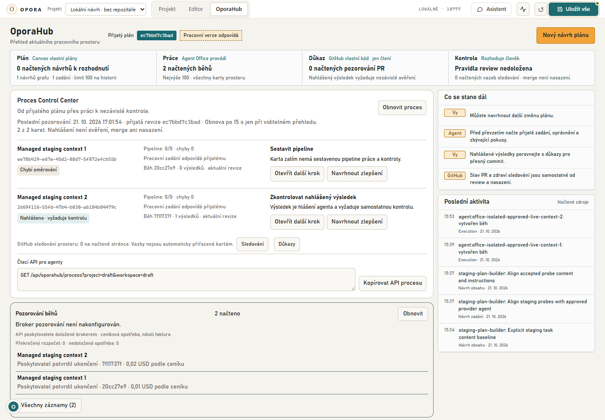

# OporaHub v procesu Control Center

Snímek ukazuje doložený stagingový průchod; není to stav produkčních projektů.

OporaHub je společný přehled procesu, nikoli druhý zapisovatelný stavový automat.
Canvas vlastní přijatý plán a pipeline karty, execution ledger oprávnění a nahlášené
výsledky, GitHub pozorování kódu. Projekce tyto podklady spojí pro aktuální projekt
a workspace; čtení nevolá model, GitHub ani poskytovatele vykonavatele.

## Kontrakt integrace

- `GET /api/oporahub/process?project=…&workspace=…` vrací
  `schema: opora.process-sync/1`, scope, aktuální přijatou revizi, čas načtení,
  položky karet a výslovné meze výřezu. Volitelný `nodeId` vrátí jedinou kartu.
- Položka obsahuje identitu karty, pipeline, shodu pracovního zadání s přijatým,
  dostupnost převzetí podle uložených podkladů, souhrn posledního execution a jeho vztah k revizi,
  počty nahlášených výsledků a konkrétní další krok s odkazy na nativní API.
  Evidovaný běh není nové potvrzení autority; tu znovu ověří claim, heartbeat
  nebo odevzdání. Vyčerpaný počet nových pokusů sám neukončuje stávající běh.
- Nahlášený výsledek žádá nezávislou kontrolu. PR merge, lidské dokončení karty,
  ověření a nasazení jsou samostatné skutečnosti. Historický výsledek se při
  změně přijaté revize nepřepíše ani nevydává za výsledek aktuální revize.
- Procesové soubory `/api/processes` nemají workspace ani vazbu na přijatou
  revizi. Mohou být odkázané jako projektová historie, nesmějí měnit execution
  ani se automaticky synchronizovat do `done`.
- Běžný `node-brief` doplní odkaz na tuto projekci a execution/proposal API.
  Jde o živou orientaci; nenahrazuje neměnné assignment ani neposkytuje token.
- Zlepšení z práce a kontroly se vracejí jako nativní návrhy zadání, grafu nebo
  obsahu s aktuálním základem. Jejich přijetí nadále podléhá lidskému review a CAS.
  Agent nemění vlastní zadání automatickým potvrzením.

## Rozhraní

Přehled OporaHubu obsahuje modul „Proces Control Center“ s kartami, stavem,
dalším krokem a vstupem do existujících detailů. Pravidelně obnovuje uložené
podklady a po změně projektu zahodí předchozí výsledek; pozdní odpověď nesmí
přepsat nový scope. Chyba se zobrazí, starý stav se nevydává za aktuální.
Při obnově nebo chybě může zůstat zobrazené poslední pozorování s výslovným
označením; akce karet jsou do získání čerstvých podkladů zablokované. Tím se
zachová prvek pro návrat fokusu po zavření detailu. Výslovně zvolená karta,
která chybí ve starším zadání, nikdy není nahrazena první jinou kartou;
editor vyžádá obnovu podkladů a výběr karty přitom zachová.
Návrh zlepšení otevře existující editor návrhů; žádný nový model se nespouští.

## Ověření a meze

Regrese pokrývá scope, chybějící přijetí, pracovní rozdíl, aktivní a nahlášený
běh, historickou revizi, samostatné lidské dokončení a nepravdivost automatického
merge/deploy. Browser ověří přehled, detail a mobil; změnu scope kontrolují
regrese čtecího cyklu. Samotná projekce neprovádí produkční migraci, merge PR,
automatické přijetí ani placené spuštění.

Ověřená produktová revize `2cc68d1df23a4d5f74eb4ebb5d9cd0e63cf03e7c`:
frontend **234 souborů / 1 612 PASS**, TypeScript a produkční build PASS;
38 cílených kontrol výběru, obnovování a fokusu PASS. Backendové cílené
kontroly mají 13 PASS, nové moduly prošly Ruff. Agentí CLI a skill mají
33 PASS. U dotčených dokumentů zůstaly tři původní nálezy odkazů, žádný nový.

Dokončené `uv run --no-sync pytest backend -q`: **3 099 PASS / 4 skip / 2 fail**
za 26 minut 8 sekund. Obě chyby jsou uvedené v `tools/verify.py` jako známé
environmentální chyby Graphify: generování přes oficiální balíček a skutečný
map-refresh. Logy potvrzují chybějící runtime `graphifyy==0.9.24`; procesová
integrace jeho kód nemění. Celá backendová sada proto není zelená.

| Dokončený lokální záznam | SHA256 |
|---|---|
| oporahub-process-sync-backend-full.log | `28f2dbaebd3d09f009a642a57e5721013557cf66492a05c697d1384627fd454e` |
| oporahub-process-sync-frontend-verified.log | `2473fe3ea485eddd155e32f496b5a8e668c4bbe15415dd7e353ab78122c2e292` |
| oporahub-process-sync-build-verified.log | `b8e6f3d089fa96ba475c616a41f0ccb2dea4953744d122afa2a22dc4144b9e4d` |

Záznamy jsou v lokálním Temp adresáři, nejsou součástí repozitáře; hash pouze
identifikuje zachovaný soubor. Nejde o nový běh ani o nezávislou certifikaci.

[Zmrazený náhled](http://127.0.0.1:18777/?screen=canvas&project=draft&workspace=draft&environment=hub)
obsahuje kopii skutečné uzavřené stagingové historie, nikoli nová modelová volání.
Browser ověřil přesnou kartu návrhu zlepšení i execution detail, 0/1 nativních
výsledků, skutečnou obnovu po 15 sekundách a návrat fokusu po Esc i ✕ na původní
prvek. Light/dark a mobil 390 px prošly bez JS chyb a vodorovného přesahu;
sedm reprezentativních POST vrací 403. Náhled nemá klíče ani aktivního brokera.
Lokální záznam `oporahub-process-preview-2cc68d1-browser-result.json` má SHA256
`5b4e17ae2ee3333c3b73d3a4d968f2d38f0a55bf0ebe7be2c5d5bbe2d1861220`.
