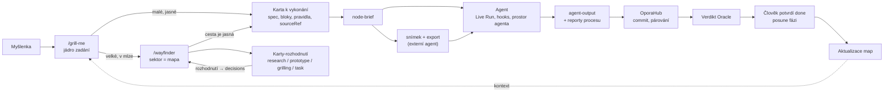

# Workflow OPORA: od myšlenky k produkčnímu dílku

Jedna pipeline pro všechny projekty. Skilly `/grill-me` a `/wayfinder` ji otevírají: zpřesní jádro zadání a výsledek zapíšou do prvků, které OPORA už má (sektor, karta, spec, bloky, pravidla, vazby, rozhodnutí). Agent pak dostane úplný `node-brief` a nepálí tokeny na práci mimo podstatu aplikace. Každá karta je dílek, který navazuje na existující komponenty a vazby.

Stav: **schváleno a zavedeno** (2026-10-01). Inventura je ověřená proti kódu; skilly `grilling` a `wayfinder` zapisují podle mapování v §3, operace popisuje `.claude/skills/opora-control-center/references/workflow.md`. Kontrakt karty zůstává v [karta-pro-agenty.md](karta-pro-agenty.md), předání modelům v [predani-modelum.md](predani-modelum.md).

## 1. Inventura (ověřeno proti `backend/`, 108 rout v `backend/app/factory.py`)

| Funkce | Co dělá | Endpoint / kód | Kdo | Stav |
|---|---|---|---|---|
| Projekt, workspace | git: `main` jen ke čtení + workspace na uzel; lokální projekt: jen `draft` | `/api/bootstrap`, `/api/project-workspaces`, `/api/workspaces`, `/api/sync`, `/api/local-project`, `/api/empty-project`, `/api/connect` | UI, agent čte | hotovo |
| Rozdíly podle druhu projektu | `localProject`, `legacyFree`, výchozí workspace | `frontend/shared/project-capabilities/logic/project-capabilities.ts` | UI | hotovo |
| Graf | uzly `node / sector / comment / area`, vazby `next / action / rule / block / flow`, digest, `undo` | `/api/view`, `/api/graph`; `backend/canvas/graph.py` | UI + agent | hotovo |
| Odstranění | náhled s digestem a potvrzení | `/api/removal-preview`, `/api/remove` | UI, agent | hotovo |
| sourceRef | `{origin: existing\|planned, path, kind}`, kontrola proti disku | `graph.py`, `canvas_service.py` | UI, agent | hotovo |
| Kresba | Excalidraw na vrstvu, obrázky (PNG/JPEG/WebP/GIF do 10 MB), kontext wireframu | `/api/drawing`, `/api/drawing-file(s)`, `/api/wireframe-context` | UI | hotovo |
| Spec, text, deník, odkazy, podklady | `goal / non_goals / acceptance` s historií; text; deník po dnech; obrázky | `/api/node-spec(+history)`, `/api/node-text`, `/api/node-journal`, `/api/node-links`, `/api/node-materials/*` | UI + agent | hotovo |
| Stav Desktop v3 | jeden revizovaný dokument `{settings, rules, decisions, nodes, tickets, edges}` | `/api/desktop-v3/state` | UI + agent | hotovo |
| Pravidla | projekt `must/must_not` se scope `project/path/node`; pravidla karty | stav Desktop v3 | UI, agent | hotovo |
| Rozhodnutí | `{id, text, pinned, path, nodeId, createdAt, by}` | stav Desktop v3, `agent-output.decisions` | UI + agent | hotovo |
| Fáze karty | `discover → define → build → verify → live`; postup vpřed jen se splněnými kritérii | stav Desktop v3 | UI | hotovo |
| Bloky splnění | stav `open/met/unmet/blocked`, podmínka, větve `onMet/onUnmet`, porty, úkoly | `/api/desktop-v3/block` | agent + UI | hotovo |
| Balíček pro model | `opora.node-brief/1` vč. `orientation`, `communication`, `roleMemory`, `knowledgeGraph`, `graph.parent` | `/api/desktop-v3/node-brief` | agent | hotovo |
| Podklady pro externího agenta | preview → neměnný snímek → export `tasks/<node>.md` (`depends_on` z příchozích vazeb) | `/api/desktop-v3/packet/*` | UI + agent | hotovo |
| Prostor agenta | `frame / log / failures / fixes / handoff`, fraktální předávka | `/api/desktop-v3/agent-workspace(-summaries)` | agent + UI | hotovo |
| Výstup modelu | `opora.agent-output/1`: bloky, zprávy na vazbách, návrh `done`, rozhodnutí | `/api/desktop-v3/agent-output` | agent | hotovo |
| Uzavření karty | agent navrhne, člověk potvrdí; zamkne bloky, prostor i hooky | stav Desktop v3 | člověk | hotovo |
| Zprávy na vazbách | `log / summary / handoff / improvements / errors` | `state.edges` | agent | hotovo |
| Adresované zprávy | `handoff / question / answer / blocker / result / correction` + potvrzení | `/api/desktop-v3/agent-messages`, `/agent-message-receipt` | agent + UI | hotovo (v1) |
| Tickety | `{id, title, priority, status open/doing/done, nodeId, sessionId, createdBy}` | jen uvnitř stavu Desktop v3 | agent zapisuje | **jen backend, UI chybí** |
| Trace, tagy, pipeline akcí | dohledání ID, index tagů, knihovna akcí | `/api/desktop-v3/trace`, `/tags`, `/pipelines` | UI, agent | hotovo |
| Procesy | `draft → running → done ⇄ repair`, kroky s důkazem, reporty | `/api/processes/*` | Live Run + agent | hotovo |
| Live Run | vazba session ↔ uzel (orchestrator/worker), telemetrie běhů | `/api/node-sessions`, `/api/agents/*` | UI + agent | hotovo |
| Agent hooks | Claude Code hooky: povolené cesty, limity, TTL, pauza/stop, ACK revize zadání | `/api/agent-hooks/*` | člověk nastaví | hotovo |
| Paměť role | OpenViking: recall, remember, lend; zrcadlí prostor agenta | `/api/memory/*` | automatika + člověk | hotovo (volitelné) |
| Mapy | Archify (jediný model: Claude Code Sonnet), Graphify (bez modelu), automatika po mergi | `/api/archify/*`, `/api/graphify/*`, `/api/map-refresh/*` | UI, automatika | hotovo |
| Pravda a dokončení | echo, verdikt Oracle (`canCommit/canMerge/blocking`), commit specu, párování commitů | `/api/sync-report`, `/api/opora-commit(s)`, `/api/opora-merge` | člověk, orchestrátor | jádro hotovo |
| Linear | jen kontrakt | — | — | nezačato |
| Vzdálený přístup | tunel s tokenem, hooky jen z loopbacku | `/api/access/*` | člověk | hotovo |
| Ostatní | seznam skillů Claude Code, LSP, sémantické hledání, strom a soubory workspace | `/api/claude-code/*`, `/api/code-intelligence/*`, `/api/semantic-search/*`, `/api/workspace/*` | UI | hotovo |

### Rozpory mezi skillem, dokumenty a kódem (opraveno 2026-10-01)

1. `node-sessions/bind`: `references/api.md` a `live-run.md` vynechávají povinné `runId`, `parentSessionId`, `confirmed: true`, takže požadavek podle návodu skončí 409.
2. Pohled „Live Run → Tickety“ popsaný v `live-run.md` a `external-agent.md` ve frontendu neexistuje.
3. `references/api.md` nezná adresované zprávy, `trace/tags/pipelines`, zakládání a přechody procesů, `/api/memory/*`, `node-materials` a `packet/preview.blockId`.
4. `pamet-agentu.md` zmiňuje `context.memory.rules` v `node-brief`. Takový klíč neexistuje, pravidla jsou v `boundaries`.
5. `agent-output.blocks[].note` se ověří a zahodí. Dokumentace to neuvádí.
6. `postup-vyvoje-projektu.md` (bez worktree, lokální složka) a `PRODUCT-CONTRACT.md` (worktree na WorkUnit) popisují dva režimy. Oba v kódu existují a rozhoduje druh projektu.

## 2. Pipeline

| # | Krok | Vstup | Výstup v OPORA | Kdo | Brána k dalšímu kroku |
|---|---|---|---|---|---|
| 1 | **Grilling** | myšlenka, `node-brief` sektoru/projektu, mapa Graphify/Archify | kola otázek v `agent-workspace.log` karty, odpovědi jako `decisions` (`nodeId` = karta) | člověk + model | frontier otázek je prázdný a člověk potvrdí shodu |
| 2 | **Rozcestí** | výsledek grillingu | malé a jasné: rovnou krok 4; velké a v mlze: krok 3 | model navrhne, člověk rozhodne | výslovná volba |
| 3 | **Wayfinding** | cíl (Destination) | sektor = mapa, karty-rozhodnutí, vazby `next` jako blokace, komentáře na plátně jako mlha | model + člověk | žádná otevřená karta-rozhodnutí v sektoru |
| 4 | **Zadání karty** | rozhodnutí z mapy | spec (`goal / non_goals / acceptance`), bloky s podmínkami, pravidla, `sourceRef` nebo vazba na existující uzel, `agentRole`, fáze `define` | model navrhne, člověk upraví | kontrola zapadnutí (viz níže) a kritéria nejsou prázdná |
| 5 | **Balíček** | karta | `node-brief` (u externího agenta navíc snímek a export) | automatika | `harness.stopConditions` neobsahuje chybějící podklad |
| 6 | **Vykonání** | `node-brief` | Live Run vazba, hooky (povolené cesty), `agent-workspace`, adresované zprávy, `agent-output`, reporty procesu | agent | `agent-output.done.proposed` a testy s výstupem |
| 7 | **Pravda** | commity | párování (`Opora-Node` trailer, cesty), echo, verdikt Oracle | OporaHub | `canMerge` |
| 8 | **Uzavření** | verdikt + výstup | `done.confirmed`, fáze `verify → live` | člověk | — |
| 9 | **Mapy** | merge do main | Archify, Graphify, které jsou kontextem pro další kroky 1 a 4 | automatika | — |

**Kontrola zapadnutí (krok 4).** Karta k vykonání vznikne jen tehdy, když splní všechny tři podmínky:
- má rodiče (sektor) a alespoň jednu vazbu nebo `sourceRef` na existující komponentu;
- v `goal` říká, čemu v cíli projektu (`project-settings`, cíl sektoru) slouží;
- odkazuje na rozhodnutí, ze kterého vzešla.

Opírá se to jen o existující pole. Nic nového se nestaví.

**Modely v pipeline.** Grilling a wayfinding drží hlavní vlákno (Opus 5.5 `medium`–`high`, Fable 5.1 na velké mapy). Research karty dělá subagent. Vykonání karty podle druhu: rutina Sonnet 5.5 `medium`, architektura Opus 5.5. Detail je v [predani-modelum.md](predani-modelum.md).

## 3. Mapování wayfinderu a grillingu na OPORA

| Pojem skillu | Prvek OPORA | Endpoint dnes | Mezera |
|---|---|---|---|
| Mapa (`wayfinder:map`) | sektor (`kind: sector`) | `/api/graph` | ne |
| Destination | spec sektoru `goal` (+ `acceptance` = jak poznáme, že je cesta jasná) | `/api/node-spec` | ne |
| Notes | `agent-workspace.frame` sektoru (skilly a preference pro tuto mapu) | `/api/desktop-v3/agent-workspace` | ne |
| Decisions so far | `state.decisions` s `nodeId` karet sektoru; důležité `pinned` | `/api/desktop-v3/agent-output` (`decisions`) | ne |
| Not yet specified (mlha) | komentáře (`kind: comment`) na vrstvě sektoru | `/api/graph` | ne |
| Out of scope | spec sektoru `non_goals`; vyřazená karta uzavřená s poznámkou „mimo rozsah“ | `/api/node-spec`, `done` | ne |
| Ticket | karta (`kind: node`) uvnitř sektoru | `/api/graph` | ne |
| Typ ticketu | předpona názvu `[research] / [prototype] / [grilling] / [task]` (konvence jako `[external:…]`) | `/api/graph` | **ano, slabá**: typ je předpona názvu a nemá pole; vrstva, stav, model, effort a termín pole mají (`card`, `docs/kontext-karet-a-index.md`) |
| Otázka ticketu | spec karty `goal`, `acceptance` = co je odpověď | `/api/node-spec` | ne |
| Blokace | vazba `next` z blokující karty na blokovanou; `packet.depends_on` ji už takto čte | `/api/graph` | ne |
| Frontier | karty sektoru bez `done.confirmed`, jejichž všechny příchozí `next` vedou z uzavřených karet, a nejsou převzaté | výpočet z `/api/view` + `/api/desktop-v3/state` | ne (čtecí příkaz `frontier` v `opora_read.py` existuje) |
| Claim | `agent-workspace.frame` řádek „Převzato: <session/role> <ISO>“, `by: agent`; nově Live Run vazba session ↔ karta | `/api/desktop-v3/agent-workspace`, `/api/node-sessions/bind` | **ano, vědomě**: není výlučný zámek. Pro jednoho člověka s jedním vláknem nevadí |
| Resolution comment | `agent-output`: `decisions` + `done.proposed` + zpráva na odchozí vazbě (`summary`, `handoff`) | `/api/desktop-v3/agent-output` | ne |
| Zavření ticketu | `done.confirmed` potvrdí člověk (HITL odpovídá wayfinderu) | `/api/desktop-v3/state` | ne |
| Asset (prototyp, research) | podklad karty (`materials`), text karty pro nálezy; větev `research/<name>` v gitu projektu | `/api/node-materials/*`, `/api/node-text` | ne |
| Grilling – kolo otázek | `agent-workspace.log` karty (otázky + doporučení + odpovědi) | `/api/desktop-v3/agent-workspace` | ne |
| Grilling – výsledek | `decisions` s `nodeId`; u velké práce spec sektoru | `agent-output`, `/api/node-spec` | ne |
| Domain-modeling | `GLOSSARY.md` / ADR v repu projektu (kód je v gitu); odkaz jako podklad karty | `/api/node-materials/*` | ne |
| Tracker doc „Wayfinding operations“ | `issue-tracker-opora.md` | — | **ano**: nový soubor skillu (ne kód aplikace) |

**Tickety ve stavu Desktop v3 (`state.tickets`) zůstávají, k čemu jsou.** Slouží jako hlášení externího agenta (`[external:blocked]`) a celoprojektové problémy. Karty-rozhodnutí je nenahrazují a ony nenahrazují karty. Jejich chybějící UI je samostatná známá mezera, mimo tento návrh.

## 4. Funkce, které se nesmí odříznout

Na každou z nich pipeline buď navazuje, nebo ji výslovně nechává beze změny:
- revize a digest u každého zápisu, `readOnly` u main, kontrola Origin, 409 bez force;
- `undo` vs. skutečné odstranění přes náhled a potvrzení;
- fáze karty s bránou kritérií;
- uzavření karty potvrzuje jen člověk;
- `node-brief` jako jediný balíček pro model;
- snímek a export pro externího agenta (export není souhlas s implementací);
- fraktální předávka, zprávy na vazbách, adresované zprávy s `identityVerified: false`;
- tickety ve stavu Desktop v3 s konvencí `[external:…]`;
- procesy s kroky a důkazy, Live Run, agent hooks s povolenými cestami;
- paměť role (OpenViking);
- Archify jako jediný model spouštěný aplikací, Graphify, automatika map;
- OporaHub, párování commitů, verdikt Oracle;
- tunel s tokenem jen v prostředí;
- „Jedno rozhraní pro všechny projekty“ přes `project-capabilities.ts`;
- oba režimy projektu (lokální složka bez worktree, git projekt s workspace).

## 5. Mezery a co se změnilo

Kód aplikace: **žádná změna** v backendu ani frontendu není nutná. Mapování stojí na existujících endpointech.

Soubory:
- `~/.claude/skills/setup-matt-pocock-skills/issue-tracker-opora.md`: nový, „Wayfinding operations“ nad API OPORA;
- `~/.claude/skills/wayfinder/SKILL.md`: odstavec „Projekt v OPORA → tracker OPORA“; jinak beze změny;
- `~/.claude/skills/grilling/SKILL.md`: odstavec „Projekt v OPORA → kola do `agent-workspace.log`, rozhodnutí přes `agent-output`“; jinak beze změny;
- `.claude/skills/opora-control-center/references/workflow.md`: nový, tato pipeline v krátké podobě pro agenta, plus řádek v tabulce `SKILL.md`;
- `.claude/skills/opora-control-center/scripts/opora_read.py`: příkazy `node-brief` a `frontier` (jen GET). Zavírá rozpor 3 a mezeru „Frontier“;
- tento dokument a `docs/predani-modelum.md`.

Rozpory 1–9 jsou opravené v dokumentaci a referencích skillu samostatným commitem.
